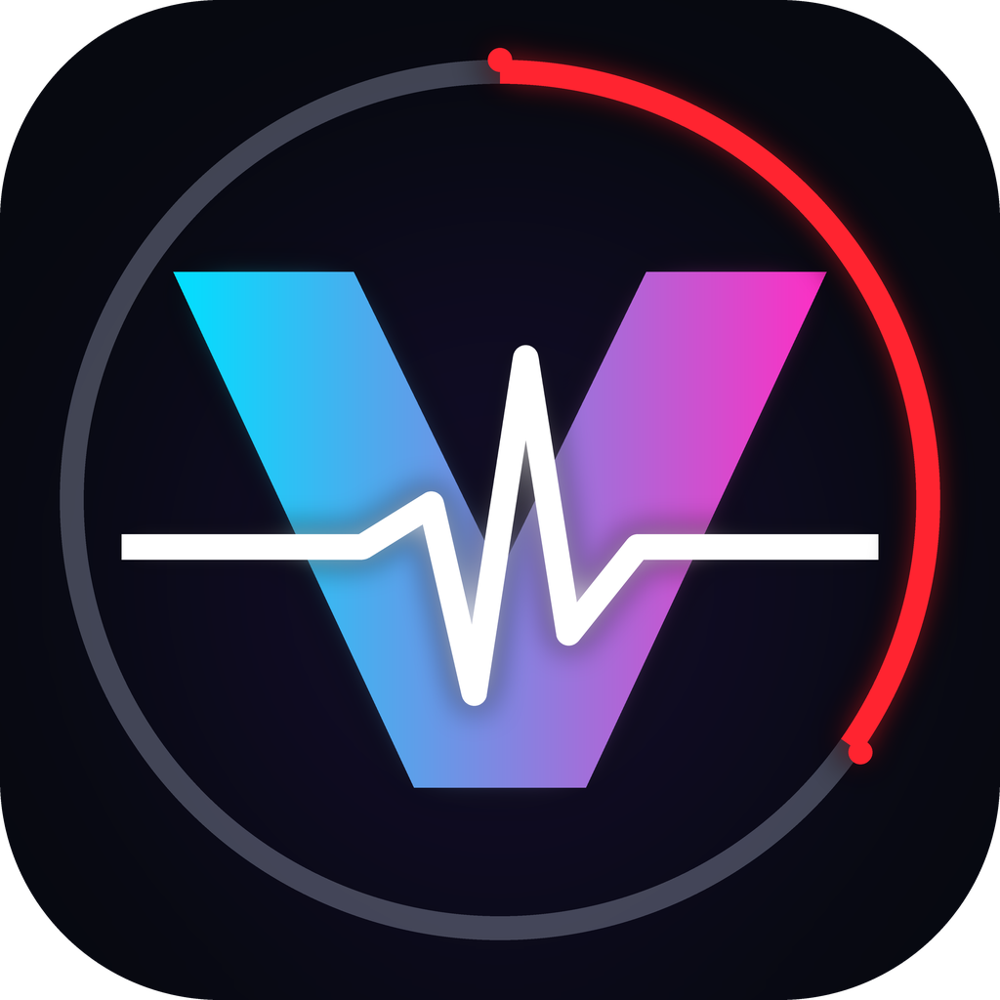

  

<h1 align="center">ViDeck Pulse</h1>

<strong>Visuales sincronizados con el tempo para sets de DJ.</strong>

ViDeck Pulse sigue los decks de **Traktor Pro 4**: lee el título, los BPM y el reloj de cada deck desde la ventana de Traktor (OCR + análisis de píxeles, sin MIDI) y reproduce videos sincronizados con el tempo mediante mpv, con crossfades en OpenGL y visuales aleatorios. Windows 10/11. Proyecto independiente, sin relación con Native Instruments.

> **Estado:** estable v2.00 u1. Soporte actual: **Windows 10/11 + Traktor Pro 4, con 2 decks (A y B)**. El modo de 4 decks de Traktor aún no está soportado. [Read in English](README.md).

  
  
  
  
  
  
  

## Cómo funciona

Tienes un video por canción (con el nombre de la canción). Cuando cargas una canción en un deck y das play, ViDeck Pulse busca su video, lo inicia en la posición correcta y lo acelera o lo frena para que siga el tempo que muestra Traktor. Cuando el siguiente deck toma el relevo, el visual cambia con un crossfade. Las canciones sin video reciben un visual aleatorio, así que la pantalla nunca queda vacía.

Funciona **mirando la ventana de Traktor**, no escuchando el audio ni hablando con Traktor: sin MIDI, sin captura de audio y sin plug-ins.

## Características

### Sigue tus decks

- **Lee solo las zonas del deck y del mixer** de la ventana de Traktor (título, BPM, tiempo restante, medidor de nivel) mediante OCR y análisis de píxeles.
- **Sabe qué está sonando de verdad**: combina el reloj del deck (los dígitos del tiempo restante solo cambian mientras la canción avanza) con el medidor de nivel. El visual se detiene solo cuando el medidor está en silencio **y** ningún deck avanza, así que un silencio dentro de una canción no interrumpe el video.
- **Detección automática del diseño**: encuentra por sí mismo las zonas de lectura, también con Traktor maximizado o en pantalla completa, y se puede recalibrar a mano.
- **Discreto con Traktor**: solo lee la imagen de la ventana. No la mueve, no le da el foco, no la minimiza ni la modifica, no inyecta código y no usa Desktop Duplication, así que no compite con Discord ni con OBS por la captura de la ventana cuando transmites la ventana de Traktor.

### Sincronía de tempo

- **La velocidad sigue los BPM**: velocidad de reproducción = BPM de Traktor / BPM base del video (limitada de 0,5x a 2x). Los cambios pequeños de tempo se aplican al instante; un dígito mal leído nunca cambia la velocidad.
- **Sincronía de posición**: el video se coloca donde está la canción (duración de la canción menos el tiempo restante) y se corrige con saltos precisos cuando se desfasa; las comprobaciones son más frecuentes cerca de los inicios y de los cambios.
- **Atento al deck en espera**: mientras suena el deck A, la canción cargada en el deck B ya está validada y, con Sync activo, su nuevo BPM se anticipa, de modo que el video de B parte con la velocidad y la posición correctas cuando toma el relevo.
- **Siguiente visual por adelantado**: cuando la canción actual está por terminar, se prepara el visual del siguiente deck y entra con la transición configurada.

### Canciones y videos

- **Vinculación automática**: cargas una canción en un deck y, si el nombre de un video coincide con el título (y la duración también), los vincula solo. Cada vínculo se puede editar a mano.
- **Doble verificación** (título y duración) antes de usar un video, para que un nombre parecido nunca muestre el visual equivocado.
- **Visuales aleatorios** para las canciones sin video, con su propia transición.
- **Detección automática de videos**: los videos nuevos, eliminados o renombrados se detectan sin congelar la ventana, y los vínculos siguen a los archivos renombrados.
- **Lista con colores**: visual configurado, BPM pendiente, visual aleatorio.

### Reproductor

- **Crossfade real en la GPU** (OpenGL, 60 Hz) entre visuales; crossfade, fundido a negro o corte. Una autoprueba al iniciar comprueba que la imagen realmente llegue a la pantalla y, si no, cambia sola a una alternativa.
- **Tres modos de ventana**: Ventana, Ventana Sin Bordes (sin barra de título, útil al compartir la ventana) y Pantalla completa en la pantalla que elijas; con tecla de atajo opcional para cambiar.
- **Resolución de salida** de 1080p o 720p; cada video conserva su propia frecuencia de cuadros.
- **Alertas de salud del video**: avisa cuando un video funciona con mal rendimiento y detecta la pantalla negra.

### Preparar videos

- Analiza tus videos (ffprobe) y te dice cuáles se verán fluidos y cuáles conviene convertir (frecuencia de cuadros constante, fotogramas clave frecuentes, H.264 de 8 bits 4:2:0).
- Convierte con ffmpeg **conservando la misma tasa de bits de video**; el audio se copia sin tocar.
- **Convierte en el sitio, con seguridad**: el archivo convertido reemplaza al original (que va a la **Papelera de Windows**) o se guarda a su lado como `nombre [Converted].mp4`. Antes de tocar el original se verifica el archivo nuevo (duración, códec, fotogramas, audio, decodificación completa, SHA-256), nunca se sobrescribe nada, los vínculos de las canciones pasan al archivo convertido y todo se deshace si un paso falla.

### Comodidad

- **Panel de estado** por deck (canción, video validado, velocidad esperada, estado de la sincronía), barra de estado con avisos y errores, y registro de errores opcional.
- Interfaz en **español e inglés**, que se cambia desde Ajustes; el instalador pregunta el idioma y lo usa como idioma del programa.
- **Ventanas adaptables** para pantallas pequeñas (modos Completo / Compacto, automático o manual).
- **Bajo uso de CPU** y trabajo en segundo plano con prioridad baja.
- **Gestor de componentes**: ffmpeg y libmpv se descargan de fuentes públicas conocidas, se verifican con SHA-256 y quedan en la carpeta propia del programa; **Legacy Mode** permite volver a las versiones con las que se probó cada lanzamiento.
- **Aviso de actualización**: una sola vez al iniciar (y desde la ventana «Componentes») comprueba si hay una versión estable más nueva en este repositorio y solo te avisa; nunca descarga ni instala nada por sí solo.
- **Portable o instalado**: los datos quedan junto al programa (portable) o en `%APPDATA%\ViDeck Pulse` (instalado), con rutas relativas para que puedas mover la carpeta. La carpeta de videos por defecto es `Videos\ViDeck Pulse\Videos` dentro de tu carpeta Videos de Windows (instalado) o una carpeta `Videos` junto al programa (portable); se cambia con **Cambiar ruta…**.

## Requisitos

- Windows 10 u 11.
- **Traktor Pro 4** (la ventana que lee el programa), con **2 decks (A y B)**: la disposición de 4 decks aún no está soportada.
- **Tesseract OCR**, **libmpv** y **ffmpeg** (este último se usa en «Preparar videos»). **No se incluyen** en este repositorio ni en sus versiones publicadas: la ventana del primer inicio indica qué falta, de dónde viene y cuál es su licencia, y tú decides si lo instalas.
- Para ejecutarlo desde el código fuente: Python 3.12 y `pip install -r requirements.txt`, y luego `python main.py`.

## Primeros pasos

1. Descarga el instalador o el zip portable desde [Releases](../../releases) y verifica su SHA-256 con `SHA256SUMS.txt`.
2. Abre ViDeck Pulse, elige la carpeta con tus videos y pulsa **Iniciar motor** con Traktor visible.
3. Carga una canción en un deck: si un video coincide con su título y su duración, se vincula solo (si no, vincúlalo en Ajustes). Escribe una sola vez los BPM base del video.
4. Pulsa play en el deck. Comparte o pon en pantalla completa la ventana **ViDeck Pulse - Reproductor**.

> [!NOTE]
> SmartScreen puede avisar del instalador de Windows la primera vez, porque aún no está firmado digitalmente: elige **Más información** y luego **Ejecutar de todas formas**. El zip portable no necesita instalación.

## Lo que no se incluye / no se promete

**Los decks C y D aún no están soportados:** a la fecha el programa sigue 2 decks (A y B), aunque Traktor puede mostrar 4. El código es abierto: cualquiera puede adaptarlo a otro software de DJ, pero **no se promete soporte ni compatibilidad con otros programas o versiones** (por ejemplo Traktor Pro 3, Traktor Play u otras marcas).

## Licencia

**GPL-3.0-or-later.** Copyright (C) 2026 JFinalXDark. Puedes usarlo, estudiarlo, modificarlo y redistribuirlo bajo los términos de la Licencia Pública General de GNU, versión 3 o, a tu elección, cualquier versión posterior. Se distribuye con la esperanza de que sea útil, pero sin ninguna garantía. Consulta `LICENSE`. Los componentes de terceros y sus licencias están en `THIRD_PARTY_NOTICES.md`.

*«Traktor» es una marca de Native Instruments. ViDeck Pulse es un proyecto independiente y no tiene relación con Native Instruments.*
